# DRIVE MUMBAI

An open-world driving game that runs in the browser. Drive the **Vayu GT-35** — an original twin-turbo AWD coupé inspired by the Nissan GT-R — or a black-and-yellow **auto-rickshaw**, a **kaali-peeli taxi** or a red **BEST bus** through one connected island city, **Colaba to Bandra** (Gateway of India, Fort, CSMT, Marine Drive, Malabar Hill, Haji Ali, Worli, Lower Parel, Dadar and over the Bandra–Worli Sea Link to Bandra West), rebuilt in 3D from **OpenStreetMap** data. Say or type **“Go to Victoria Terminus”** and the autopilot drives you there.

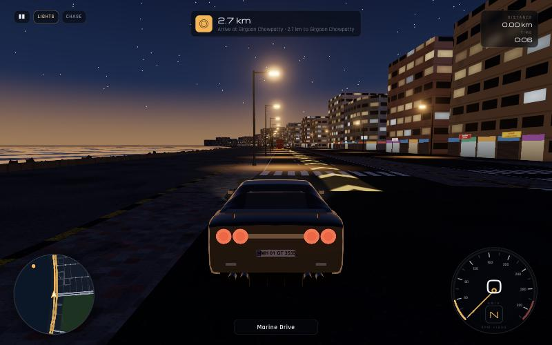

| | |
|---|---|
| 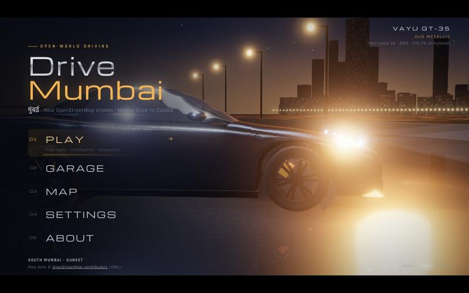 | 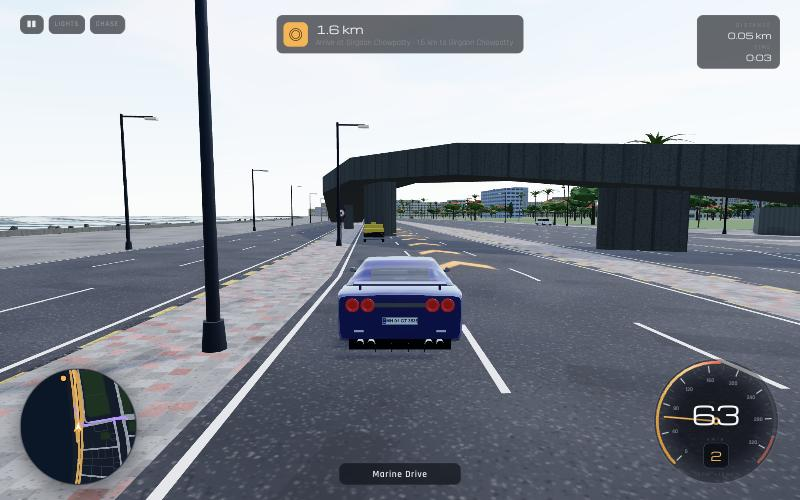 |
| 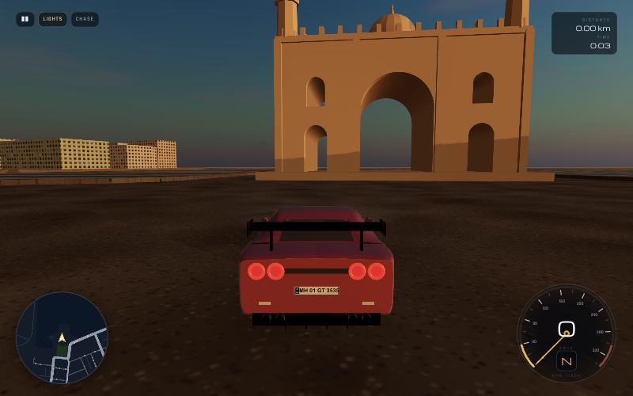 | 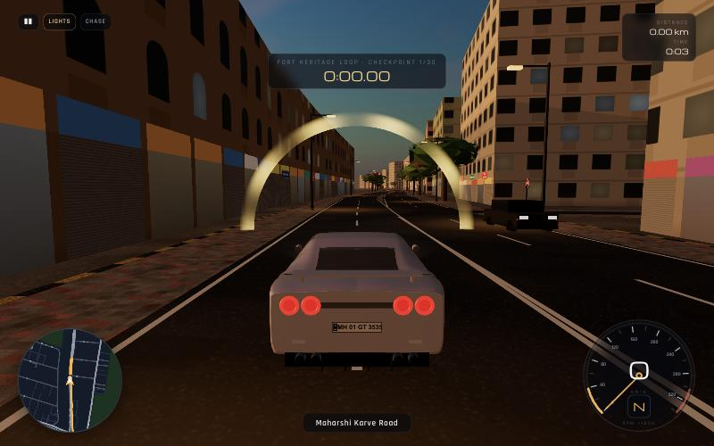 |
| 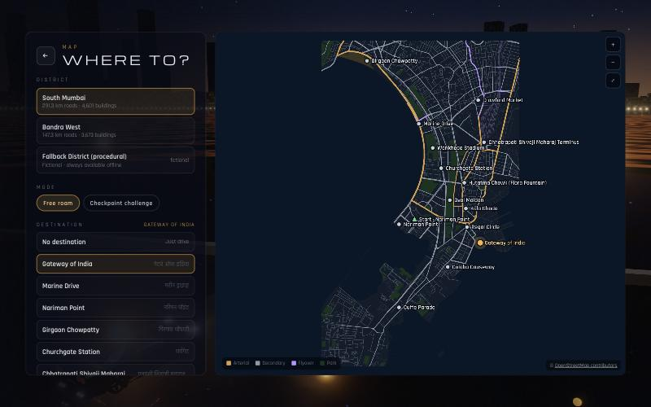 | 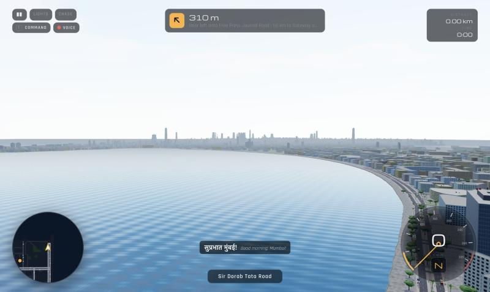 |
| 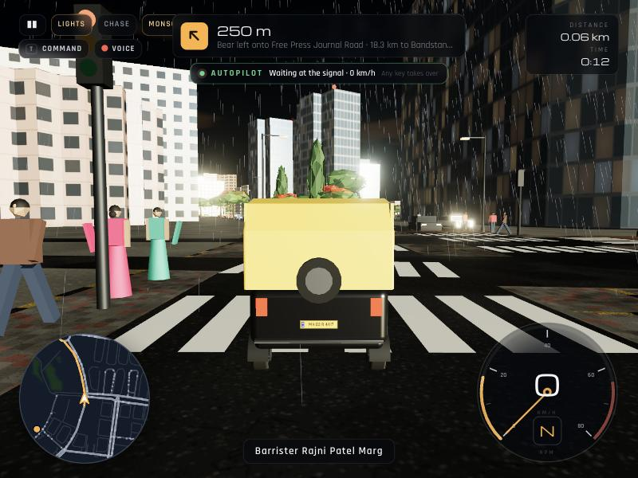 | 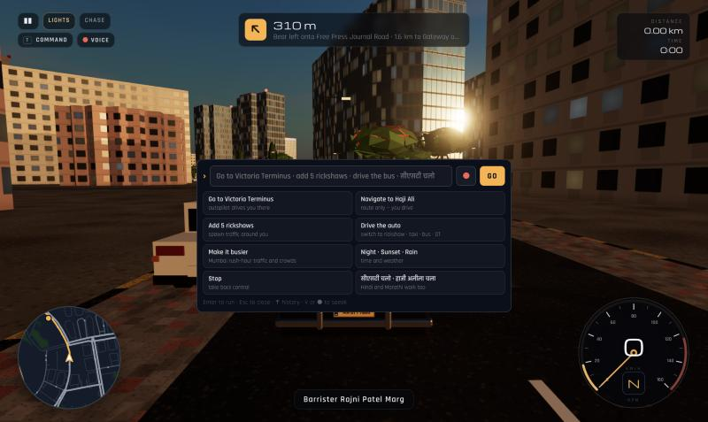 |
| 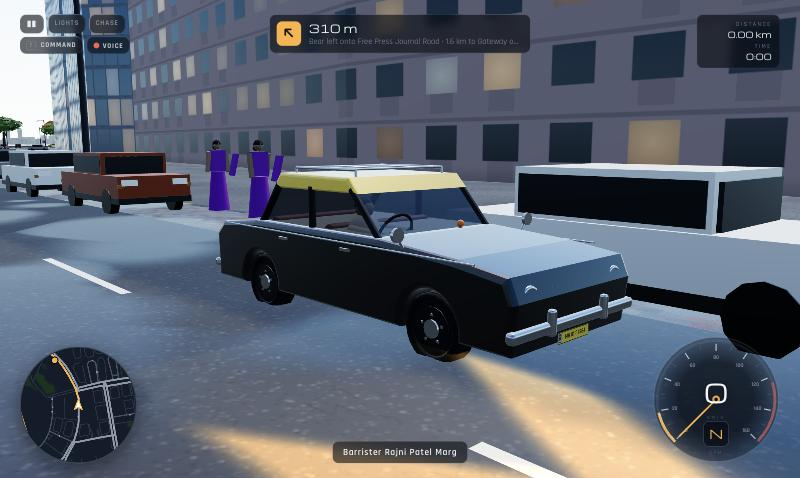 | 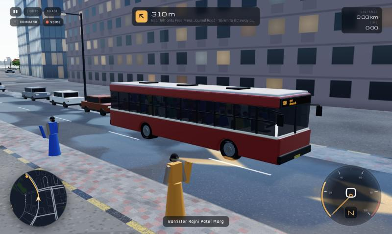 |

<p align="center">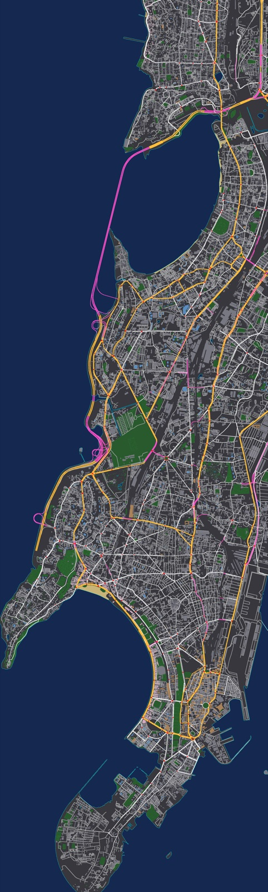</p>

> Screenshots are captured from the running game (scaled). The tall image is the import pipeline's debug render of the processed map, Colaba (bottom) to Bandra (top): water, parks, beaches, roads, flyovers and the Sea Link (violet), heritage buildings (tan), towers (blue) and signalised junctions (red).

---

## Quick start

Requirements: **Node.js 20.19+** (tested on Node 26) and a browser with WebGL 2 (current Chrome, Edge, Firefox or Safari).

```bash
npm install
```

```bash
npm run dev
```

Open the URL Vite prints (normally http://localhost:5173), click **PLAY**, and drive. The processed map data ships in `public/maps/`, so a fresh clone runs without downloading anything else.

Production build (static files in `dist/`, deployable to any static host — the build uses relative paths, so a GitHub Pages sub-path works):

```bash
npm run build
```

```bash
npm run preview
```

## Controls

| Key | Action |
|---|---|
| **W** / **↑** | Accelerate |
| **S** / **↓** | Brake — hold when stopped to reverse |
| **A** / **D** or **←** / **→** | Steer |
| **Space** | Handbrake (drift) |
| **C** | Switch camera (chase → far chase → bonnet → cockpit) |
| **H** | Horn |
| **L** | Headlights |
| **M** | Mute audio |
| **R** | Reset the car onto the nearest road, in the left lane |
| **T** or **/** | Type a command (“go to Victoria Terminus”, “add 5 rickshaws”) |
| **V** | Speak a command (microphone) |
| **G** | Autopilot on / off to the current destination |
| **Tab** | Map & destinations |
| **Esc** / **P** | Pause |

Any driving key takes over from the autopilot. Driving keys never scroll the page. A gamepad works too (triggers for throttle/brake, left stick to steer, A handbrake, B horn, X lights, Y camera, Start pause), and touch devices get on-screen pedals and steering.

## Commands, voice and autopilot

Press **T** (or click **COMMAND**) to type, or **V** (or click **VOICE**) to speak. Commands work in English, Hinglish, Hindi and Marathi, and place names are matched fuzzily against the curated landmarks (with nicknames like *VT*, *CST*, *Bombay Central*), every station and landmark in OpenStreetMap, and every named road (including colloquial names such as *Pedder Road* or *SV Road*).

| Say or type | What happens |
|---|---|
| Go to Victoria Terminus · take me to VT · सीएसटी चलो · व्हिक्टोरिया टर्मिनसला चला · Bandra le chalo | Sets the destination and the **autopilot drives you there** |
| Navigate to Haji Ali · show me the way to Marine Drive | Route only — you drive, with spoken turn-by-turn guidance |
| Add a rickshaw · add 5 rickshaws · spawn 3 buses · ऑटो लाओ | Spawns traffic around you (rickshaw, taxi, bus, truck, bike, car) |
| Drive the auto · switch to the bus · I want to drive the taxi · रिक्षा चालवा | Switches your vehicle on the spot |
| Make it busier · more traffic · less people · no traffic | Rush-hour traffic and crowds, or quieter streets |
| Night · sunset · day · rain · stop the rain | Time of day and weather |
| Stop · थांबा · रुको | Autopilot off — you have control |
| Faster · slower · honk · lights off · cockpit view · reset · where am I · help | Everything else |

The **autopilot** follows the navigation route with pure-pursuit steering in the left lane, plans its speed from the road class, upcoming curves, red lights and the vehicle ahead, honks when it is stuck behind someone (it is Mumbai), squeezes past vehicles that will not move, and pulls over at the destination. It drives through the same physics as you, so the bus takes wide turns and the rickshaw leans.

**Voice commands** use the browser's Web Speech API (Chrome, Edge, Safari; Firefox users can type). The browser asks for microphone permission the first time; the recognition language (English (India), Hindi or Marathi) is in Settings → World. Note that in Chrome and Edge, speech recognition is processed by the browser vendor's online service. Typed commands never leave the page.

## Features

**Home screen.** A cinematic night scene on the Marine Drive sea wall: the car on wet, mirror-reflective asphalt, a headlight power-on sequence (DRL sweep, double flash, volumetric beams), the Queen's Necklace arc of lights across the bay and a lit skyline, with blended camera shots that change as you hover each menu item. PLAY, GARAGE, MAP, SETTINGS and ABOUT all work and are keyboard navigable.

**Real Mumbai streets.** One connected map from Colaba to Bandra: 1,301 km of roads imported from OpenStreetMap with real names in English and (where mapped) Marathi, one-way streets, lane counts, 62 km of flyovers and bridges raised as elevated decks with parapets and pillars (J. J. Flyover, Kemps Corner, Lalbaug, the Coastal Road and the full **Bandra–Worli Sea Link** across Mahim Bay), the real coastline with sea walls and tetrapods, Back Bay, Mahim Bay, parks and maidans, Chowpatty beach, 20,951 building footprints, 235 signalised junctions, zebra crossings and 512 bus stops. Building heights use OSM `height` / `building:levels` where present and are estimated otherwise.

**Skyline and views.** Every building 14 m and taller across the whole city (14,694 of them) is always drawn in a single far-distance layer, so the Malabar Hill towers rise across Back Bay from Marine Drive and Worli and Lower Parel fill the view from the Sea Link. Tall towers get setbacks, crowns, rooftop masts, LED crown lighting at night and blinking red aviation lights. The far layer hands over seamlessly to the detailed streaming blocks as you approach. The haze was thinned so the view carries for kilometres.

**A busy city.** Up to 240 vehicles around you at the *Rush hour* setting, now including scooters and motorbikes, tempos and trucks with "Horn OK Please" tunes, and auto-rickshaws north of Mahim (they are not permitted in the island city — but you can spawn them anywhere). Pedestrians walk the footpaths; crowds pack Chowpatty and Bandstand, the Gateway, the stations (CSMT, Churchgate, Mumbai Central, Bandra), Siddhivinayak and Haji Ali, people sit along the Marine Drive sea wall and queue at bus stops, and passers-by jump out of your way (and shout at you). Parked cars and scooters line the kerbs, and vada-pav, chai, coconut-water and fruit stalls fill the commercial streets.

**Four vehicles.** Each has its own physics tune, collision footprint, cameras, engine sound and horn, and a detailed procedural model with a driver: the **GT** (below); a Mumbai **auto-rickshaw** — black body, yellow hood, CNG single with a putt-putt engine note, a meter, a spare wheel on the back, a single steering front wheel and a handlebar, 65 km/h flat out, a tight turning circle and plenty of body lean; the **kaali-peeli Premier Padmini taxi** — black with a yellow roof, chrome bumpers and over-riders, round headlamps, roof rack, column-shift four-speed; and an 11-metre **BEST single-decker** — red and cream, route 138 to CSMT on the LED board, twin rear wheels, air-horn, a full load of passengers, governed to 70 km/h, with the conductor's bell and calls at bus stops. Pick one in the Garage or switch mid-drive with a command.

**The car.** A fully procedural model (no third-party mesh): lofted body with real wheel arches, a greenhouse with glass, pillars and a kinked C-pillar, boomerang LED headlights, the signature quad round tail lights, honeycomb grille, fender vents, mirrors, ducktail spoiler or carbon track wing, quad exhausts, diffuser, forged twin-spoke wheels with brake discs and calipers, a right-hand-drive cockpit, and an Indian **MH 01** registration plate. Wheels spin and steer, the body pitches and rolls, brake / reverse / tail / head lights all work.

**Driving physics.** A fixed 120 Hz single-track vehicle model: load transfer, a saturating Pacejka-style tyre curve with a friction circle, AWD torque split with wheelspin, a twin-turbo torque curve with spool, automatic 6-speed gearbox, reverse, handbrake drifting, speed-sensitive steering, optional counter-steer and stability assist, sand and monsoon grip. Collisions with buildings, poles, trees, flyover pillars, the sea wall, map edges and traffic use proper 2D rigid-body impulses (glancing hits slide, off-centre hits spin you). A safety net guarantees the car never ends up inside a building, and **R** always returns it to a legal lane.

**Gameplay.** Free roam with **left-hand traffic** that follows lanes, curves through junctions, keeps its distance (Intelligent Driver Model), obeys the traffic signals, honks when you block it and puts its hazards on if you hit it. Working **signals** cycle at 235 real junctions. **Waypoint navigation** (A* over the directed road graph) with turn-by-turn instructions using real road names, a glowing route ribbon on the road, a destination beacon, automatic rerouting, and click-anywhere custom waypoints. **Checkpoint challenges** (Queen's Necklace Sprint, Fort Heritage Loop, Colaba Dash, Bandra Sea Face, Hill Road Run, Sea Link Run, Darshan Run, and the full Colaba-to-Bandra run) with gates every ~250 m, a timer and saved best times. The HUD has a speedometer with RPM ring and gear, a heading-up minimap with route and traffic, the current road name, trip distance and time, and "you jumped a red light" feedback.

**Graphics.** PBR materials with image-based lighting; procedural building facades (windows, arched heritage windows, glass towers, Art Deco banding, monsoon streaks, ground-floor shop fronts with signboards, windows that light up at night), rooftop water tanks, rain trees, coconut palms, flowering gulmohars and ashokas, street lights with sodium light pools, Indian road signs (speed limit, STOP, no parking, no horn, bus stop) and blue direction boards carrying real road names, painted black-and-yellow kerbs, lane markings, zebra crossings. **Day, sunset (sun setting over the Arabian Sea) and night**, plus a **monsoon** mode with rain, wet reflective roads, reduced grip and lightning. Shadows, bloom (night), haze, an animated sea, and low-detail "city beyond" blocks so the horizon is never empty.

**Garage & settings.** Choose your vehicle (GT, auto-rickshaw, taxi or BEST bus) with its spec sheet; for the GT, 11 paints (Midnight Purple, Bayside Blue, Katsura Orange, Monsoon Green and more, with metallic / pearl / gloss / matte finishes), 4 wheel finishes, 4 caliper colours, 3 aero options, window tint and a custom number plate — previewed live and saved. Settings cover quality presets (Low → Ultra), render scale, shadows, bloom, view distance, traffic (off → rush hour), crowds (off → festival), street life, four audio volumes and mute, street-voice language (Hindi + Marathi, Hindi, Marathi, English or off), voice volume, captions, the voice-command language, steering sensitivity, assist, camera, km/h or mph, FPS display, time of day and weather. Everything persists in `localStorage`.

**Audio.** Sound effects are synthesised at runtime with the Web Audio API — an engine note per vehicle (V6 twin-turbo with whistle and blow-off; the rickshaw's raspy single; the Padmini's four; the bus's clattering diesel), gear-change cuts, tyre squeal, wind and road noise, a horn per vehicle (the rickshaw's nasal peep, the bus's air horn), impacts, and Mumbai around you: positional horns from the traffic (rickshaws peep, buses blare, trucks play "Horn OK Please" tunes), temple *ghanta* bells near temples and church bells at Mount Mary, Mumbai local-train horns and rail rumble near the Western and Central lines, a crowd murmur that follows the number of people around you, the BEST conductor's bell, crows, waves, rain and thunder.

**Hindi and Marathi voices.** Street life speaks: hawkers call *“वडा पाव! गरम गरम वडा पाव!”*, *“कटिंग चहा!”* and *“नारळ पाणी!”* as you pass their stalls, the bus conductor shouts *“पुढे चला, पुढे चला!”*, would-be passengers ask *“भैया, मीटर से चलोगे?”*, and pedestrians you nearly hit yell *“अरे भाई, देख के चलाओ!”* or *“ए, बाजूला हो!”*. Navigation and the autopilot speak too (*“आगे दाएँ मुड़िए”*, *“ठीक है, विक्टोरिया टर्मिनस चलते हैं”*, *“लाल सिग्नल आहे, थांबूया”*). Every line appears as a caption with an English translation. Voices use the speech synthesiser built into your device (no recordings are downloaded); Hindi voices are common, Marathi ones are rarer, so Marathi lines fall back to a Hindi voice — and if the device has no Indian voice at all, the captions still show.

Audio starts on the first click, as browsers require; it suspends when the tab is hidden.

**Robustness.** A loading screen with progress and tips; friendly errors; if map files are missing or corrupt the game generates a clearly labelled **procedural fallback district** (it is fictional and says so) through the very same import pipeline, so the game always runs. WebGL-unavailable and GPU-context-lost cases show an explanation.

## Map coverage

| District | Area | Roads | Buildings | Signalised junctions | Elevated | Source snapshot |
|---|---|---|---|---|---|---|
| **Mumbai — Colaba to Bandra**: Colaba, Cuffe Parade, Nariman Point, Fort, Kala Ghoda, CSMT, Crawford Market, Marine Drive, Girgaon, Malabar Hill, Grant Road, Mumbai Central, Tardeo, Haji Ali, Mahalaxmi, Worli, Lower Parel, Prabhadevi, Dadar, Shivaji Park, Mahim, Bandra West | 5.9 km × 19.6 km | 1,301 km | 20,951 (14,694 in the far skyline) | 235 | 62 km | OSM, October 2026 |
| **Fallback (procedural)** | 2 km × 2 km | — | — | — | — | Fictional, generated at runtime |

What is real and what is approximated:

* **Real (from OSM):** road geometry, names, one-way rules, lane counts (where tagged), road classes, the coastline, parks, the beach, building footprints, mapped heights and floor counts, traffic signal locations, zebra crossings, bus stops, railway lines and landmark positions.
* **Approximated:** building heights where OSM has none (estimated from footprint and type), facade styles and colours, flyover deck heights (a smooth ramp profile from each bridge's ground connections; OSM does not store elevation), lane-level geometry at complex junctions, tree positions along streets and in parks (procedurally placed; mapped trees are kept), signal timings, traffic volumes.
* **Stylised:** the Gateway of India and Flora Fountain models are hand-built approximations placed at their real footprints; the menu skyline is decorative.
* **Not covered:** the eastern waterfront east of 72.848° E (parts of Mazgaon, Sewri and Wadala), everything north of Bandra, and tunnels (e.g. the Coastal Road tunnels are excluded). Beyond the edge you see low-detail "city beyond" blocks; the car is stopped at the boundary.
* **Crowds, parked vehicles and stalls** are placed procedurally (around real stations, beaches, landmarks and bus stops) — they are not real-world data.

## Map import pipeline

The pipeline turns OpenStreetMap data into compact, streamable game data. It is plain TypeScript (`src/map/pipeline/`) shared with the game, so the procedural fallback and the unit tests use exactly the same code.

```
Overpass API ──► data/osm/<district>.json ──► public/maps/<district>/
  (map:fetch)          raw cache              manifest.json, network.json,
                                              landmask.png, chunks/<x>_<z>.json
```

1. **Fetch** (`scripts/map/fetch-osm.ts`): queries the Overpass API for highways, buildings (ways and multipolygon relations), parks, water, beaches, railways, signals, crossings, bus stops, trees and named landmarks, tile by tile (≈3.3 km tiles, cached in `data/osm/tiles/` so an interrupted download resumes). A tile the public servers keep rejecting is split into quadrants automatically. Mirror fallback and exponential backoff respect busy servers. The coastline is fetched once for the whole district plus a margin. Raw output is cached in `data/osm/` (git-ignored).
2. **Build** (`scripts/map/build-map.ts` → `src/map/pipeline/`):
   * **Projection** to a local metric plane centred on the district (+X east, +Z south).
   * **Road graph** (`network.ts`): drivable ways are clipped to the bounds, split at every junction, one-way streets normalised to run a → b, lanes and widths derived from tags with defaults per road class; **flyovers** get a smooth per-point elevation from a multi-source Dijkstra over bridge chains, measured from where each chain meets ground-level road. Signals are snapped to junctions and clustered (dual-carriageway junctions share one controller); bus stops are snapped beside the carriageway.
   * **Buildings** (`buildings.ts`): rings normalised and simplified, heights and styles chosen, road-facing shop frontages detected, and any building that blocks a drivable road centreline is dropped so every road stays drivable. The Gateway of India becomes a landmark instead of a box.
   * **Land mask** (`landmask.ts`): coastline lines are rasterised as barriers, land is seeded on their left and sea on their right, then flood-filled; inland water is carved, every ground-level road corridor is forced to land, and the mask is lightly blurred. Parks and sand go in the green and blue channels. The shoreline is then extracted back out with **marching squares**, so the ground shader, the sea-wall mesh and the physics all agree on where the sea is.
   * **Trees** (`trees.ts`): mapped trees plus roadside avenues and park plantings, kept clear of roads and buildings, with coconut palms near the sea.
   * **Chunks:** buildings and trees are cut into 400 m tiles that the game streams in and out around the car.
   * **Skyline:** every building 14 m and taller also goes into `skyline.json` (towers with their real footprint, mid-rises as oriented boxes) for the always-loaded far layer.
3. **Run in game** (`src/map/MapData.ts`, `src/world/World.ts`): the manifest, road network and land mask load first; tiles are fetched on demand and built within a per-frame time budget, then unloaded when far away. Collision for each tile is registered and removed with it.

Rebuild or add a district:

```bash
npm run map:fetch -- mumbai
```

```bash
npm run map:build -- mumbai
```

To add a new area, add an entry to `src/map/districts.ts` (id, name, bounding box, spawn point, destinations, traffic mix), then run the two commands above with its id. The district appears automatically in the Map screen (via `public/maps/index.json`). To check an import by eye:

```bash
npx tsx scripts/map/debug-render.ts mumbai map-debug.png
```

Keep queries to district-sized areas and respect the [Overpass usage policy](https://dev.overpass-api.de/overpass-doc/en/preface/commons.html).

### Data format (v3)

* `manifest.json` — bounds, origin, chunk list, land-mask metadata, spawn, destinations (with Hindi / Marathi names and spoken aliases), traffic mix, attribution, statistics.
* `network.json` — `nodes` (flat x,z), `edges` (`a`, `b`, polyline `p`, optional elevations `h`, kind `k`, width `w`, lanes `l`, one-way `o`, name index `n`), `names` (English + Marathi), `signals` (junction clusters), `crossings`, `busStops`, `shore`, `rail`, `pois`, `landmarks`.
* `landmask.png` — RGB raster (R land, G park, B sand), one pixel per 4 m.
* `skyline.json` — tall buildings for the far layer: footprint, height, style and the tile each belongs to.
* `chunks/<x>_<z>.json` — buildings (`p` ring, `h` height, `m` base, `s` style, `f` frontage edges) and trees (`x, z, type`).

## Data attribution and licences

* **Map data © [OpenStreetMap contributors](https://www.openstreetmap.org/copyright)**, available under the [Open Database License (ODbL) 1.0](https://opendatacommons.org/licenses/odbl/1-0/). The processed files in `public/maps/` are a Derivative Database and are likewise available under the ODbL 1.0 (see `public/maps/*/ATTRIBUTION.txt`). Attribution is shown in the main menu, the Map screen and the About screen.
* **Vehicles, people, textures, signs, landmarks and sound effects** are generated procedurally by this project's code. No third-party 3D models, images or sound recordings are included. Spoken Hindi / Marathi lines are produced at runtime by the speech synthesiser in the player's own browser or operating system; the line texts are original to this project.
* **Fonts:** [Michroma](https://fonts.google.com/specimen/Michroma) and [Rajdhani](https://fonts.google.com/specimen/Rajdhani) (Indian Type Foundry), both SIL Open Font License 1.1, bundled via Fontsource.
* **Libraries:** three.js (MIT), React (MIT); development tools as listed in `package.json`.
* **Trademarks:** the Vayu GT-35 is an original design *inspired by* the Nissan GT-R. It is not affiliated with or endorsed by Nissan; "Nissan" and "GT-R" are trademarks of their owner. The rickshaw, taxi and bus are generic procedural models; BEST, Premier Padmini and the place names are used descriptively.
* **Code:** MIT (see `LICENSE`).

## Architecture

```
src/
  app/        GameController (bridges UI ↔ engine), app state & toasts
  engine/     WebGL renderer, bloom post-processing, main loop, quality
  menu/       Cinematic menu / garage scene
  drive/      DriveScene — loads a district and runs every system per frame; Autopilot
  commands/   Command parser (EN / Hinglish / हिंदी / मराठी), place index, voice recognition
  vehicle/    VehiclePhysics (pure, unit-tested), the fleet tunes, the GT CarModel and the rickshaw / taxi / bus models
  physics/    CollisionWorld (walls, poles, sea wall, bounds, traffic) and flyover SurfaceSystem
  camera/     Chase / far / bonnet / cockpit camera rig
  input/      Keyboard, gamepad and touch input
  map/        Map format types, projection, RoadGraph, loader + fallback, import pipeline
  world/      Streaming World, far skyline, road / building / prop / street-life builders, materials, sky & weather, ground & sea
  traffic/    Traffic AI, pedestrians and crowds, signals, vehicle models
  nav/        A* pathfinder, Navigator, checkpoint runs, challenge routes
  audio/      Procedural Web Audio engine, Hindi / Marathi voice lines and captions
  ui/         React screens (menu, garage, map, settings, about, loading, pause) and the HUD
scripts/map/  fetch-osm, build-map, debug-render, PNG encoder
tests/        Vitest suites
```

The engine is plain three.js and imperative; React renders only the overlays. Per-frame HUD values are written straight to the DOM from a `requestAnimationFrame` loop to avoid re-rendering React at 60 fps. Physics runs at a fixed 120 Hz. Everything heavy is batched: one merged building mesh per tile, instanced trees, lamps, tanks, signs and traffic, so a typical frame is ~350 draw calls including shadows.

## Scripts, tests and checks

| Command | What it does |
|---|---|
| `npm run dev` | Vite dev server |
| `npm run build` | Type-check (`tsc -b`) and production build |
| `npm run preview` | Serve the production build |
| `npm test` | Vitest unit tests |
| `npm run lint` | ESLint |
| `npm run typecheck` | TypeScript project check |
| `npm run check` | All of the above in sequence |
| `npm run map:fetch -- <id>` / `npm run map:build -- <id>` | Map pipeline |

The 76 unit tests cover the command parser (English, Hinglish, Hindi and Marathi phrasing, nicknames and typos, spawning, vehicle switching, city and weather commands), the autopilot (every vehicle reaches the destination and parks, lane keeping, speed limits, stopping at a red light and going on green, following a slow vehicle, honking and squeezing past a stopped one, pulling over on arrival), the fleet's physics (top speeds, pulling away, turning circles, torque curves), vehicle dynamics (0–100 time, top speed, braking distance, reverse, steering, handbrake drift, mid-corner stability, numerical stability, ramps), the import pipeline (projection, junction splitting, one-ways, clipping, flyover elevation, building rings and shop fronts, coastline flood-fill, shoreline orientation, roads on land, tree placement), the road graph, A* routing (shortest legal path, one-way compliance, full-district reachability), collision (walls without tunnelling, poles, bounds, tile unloading), flyover surfaces and parapets, and input (bindings, scroll prevention, edge-triggered keys, text fields, blur, menus).

## Performance

Quality presets trade resolution, shadows, bloom and streaming distance. On an Apple-silicon laptop at 1440×900 the High preset holds 60 fps (~350 draw calls, ~750k triangles including the shadow pass). Small props (trees, lamps, shop signs, tanks) are culled beyond ~600 m, tiles beyond the view distance are unloaded, and traffic is simulated only within ~420 m. On integrated GPUs start with **Medium**; on phones **Low**.

## Known limitations

* Roads are flat at ground level apart from flyovers; there is no terrain elevation (Malabar Hill is flat), and flyover heights are estimated.
* Junction surfaces are approximated with round pads; complex junctions can show overlapping markings, and turn lanes / slip lanes are not modelled for traffic.
* Building heights without OSM tags are estimates; footprints with internal courtyards are filled.
* Traffic is ambient: vehicles do not change lanes or overtake (only your autopilot does), and pedestrians always dodge — they cannot be hit.
* The autopilot is a driving aid for a game: it can still bump traffic in dense jams, and on dual carriageways it may announce arrival from the opposite side of the road.
* Voice recognition depends on the browser (none in Firefox) and Marathi recognition / speech voices are not available on every device.
* The player's car does not take visible damage.
* Areas outside the imported Colaba–Bandra box are not drivable.
* While the browser tab is hidden the simulation pauses (browsers stop animation frames for hidden tabs).
* Audio is synthesised, so engine notes are stylised rather than recordings, and voice quality depends on the device's speech voices.
