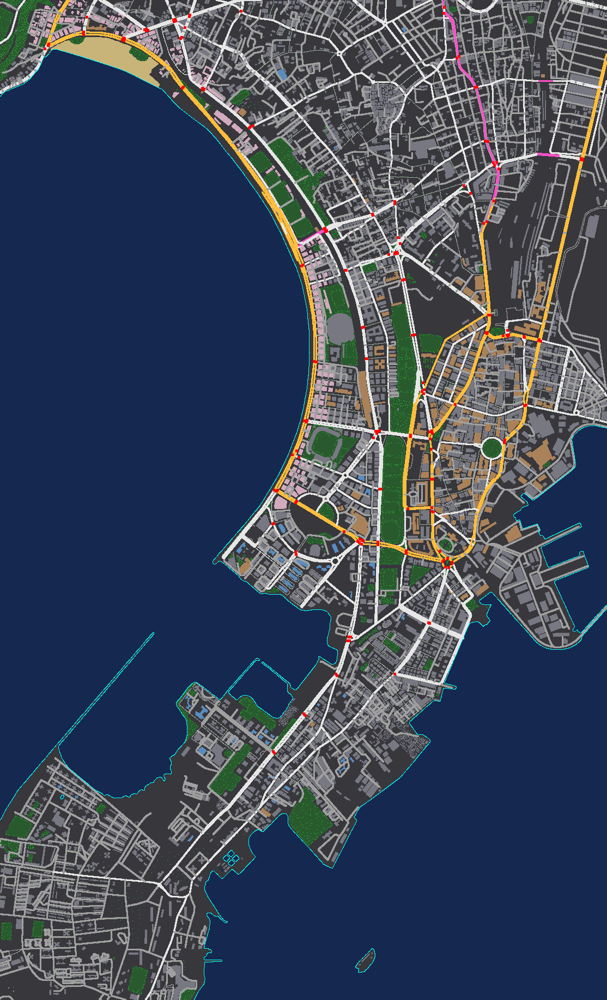

# DRIVE MUMBAI

**▶ [Play online](https://a6nkay-source.github.io/Driving-SIm/)** — runs in any desktop or mobile browser with WebGL 2; nothing to install.

An open-world driving game that runs in the browser. You drive the **Vayu GT-35** — an original twin-turbo AWD coupé inspired by the Nissan GT-R — through real streets of **South Mumbai** (Marine Drive, Nariman Point, Churchgate, Fort, Colaba, the Gateway of India) and **Bandra West**, rebuilt in 3D from **OpenStreetMap** data.


| | |
|---|---|
|  |  |
|  |  |
|  |  |

> Screenshots are captured from the running game at 1440×900 (scaled). The last one is the import pipeline's debug render of the processed map: water, parks, Chowpatty beach, roads, flyovers (violet), heritage buildings (tan), towers (blue), the Art Deco sea-face row (pink) and signalised junctions (red).

---

## Quick start

Requirements: **Node.js 20.19+** (tested on Node 26) and a browser with WebGL 2 (current Chrome, Edge, Firefox or Safari).

```bash
npm install
```

```bash
npm run dev
```

Open the URL Vite prints (normally http://localhost:5173), click **PLAY**, and drive. The processed map data for both districts ships in `public/maps/`, so a fresh clone runs without downloading anything else.

Production build (static files in `dist/`, deployable to any static host — the build uses relative paths, so a GitHub Pages sub-path works):

```bash
npm run build
```

```bash
npm run preview
```

Every push to `main` runs `npm run check` and publishes `dist/` to GitHub Pages through [`.github/workflows/deploy.yml`](.github/workflows/deploy.yml); pull requests run the same checks without deploying. A fork needs Pages turned on once: **Settings → Pages → Source: GitHub Actions**.

## Controls

| Key | Action |
|---|---|
| **W** / **↑** | Accelerate |
| **S** / **↓** | Brake — hold when stopped to reverse |
| **A** / **D** or **←** / **→** | Steer |
| **Space** | Handbrake (drift) |
| **C** | Switch camera (chase → far chase → bonnet → cockpit) |
| **H** | Horn |
| **L** | Headlights |
| **M** | Mute audio |
| **R** | Reset the car onto the nearest road, in the left lane |
| **Tab** | Map & destinations |
| **Esc** / **P** | Pause |

Driving keys never scroll the page. A gamepad works too (triggers for throttle/brake, left stick to steer, A handbrake, B horn, X lights, Y camera, Start pause), and touch devices get on-screen pedals and steering.

## Features

**Home screen.** A cinematic night scene on the Marine Drive sea wall: the car on wet, mirror-reflective asphalt, a headlight power-on sequence (DRL sweep, double flash, volumetric beams), the Queen's Necklace arc of lights across the bay and a lit skyline, with blended camera shots that change as you hover each menu item. PLAY, GARAGE, MAP, SETTINGS and ABOUT all work and are keyboard navigable.

**Real Mumbai streets.** 291 km of drivable South Mumbai roads and 147 km in Bandra West, imported from OpenStreetMap with real names in English and (where mapped) Marathi, one-way streets, lane counts, flyovers raised as elevated decks with parapets and pillars (J. J. Flyover, Marine Lines Flyover, the Bandra–Worli Sea Link approach), the real coastline with Marine Drive's sea wall and tetrapods, parks and maidans, Chowpatty beach, 4,600 + 3,700 building footprints, mapped traffic signals, zebra crossings and bus stops. Building heights use OSM `height` / `building:levels` where present and are estimated otherwise.

**The car.** A fully procedural model (no third-party mesh): lofted body with real wheel arches, a greenhouse with glass, pillars and a kinked C-pillar, boomerang LED headlights, the signature quad round tail lights, honeycomb grille, fender vents, mirrors, ducktail spoiler or carbon track wing, quad exhausts, diffuser, forged twin-spoke wheels with brake discs and calipers, a right-hand-drive cockpit, and an Indian **MH 01** registration plate. Wheels spin and steer, the body pitches and rolls, brake / reverse / tail / head lights all work.

**Driving physics.** A fixed 120 Hz single-track vehicle model: load transfer, a saturating Pacejka-style tyre curve with a friction circle, AWD torque split with wheelspin, a twin-turbo torque curve with spool, automatic 6-speed gearbox, reverse, handbrake drifting, speed-sensitive steering, optional counter-steer and stability assist, sand and monsoon grip. Collisions with buildings, poles, trees, flyover pillars, the sea wall, map edges and traffic use proper 2D rigid-body impulses (glancing hits slide, off-centre hits spin you). A safety net guarantees the car never ends up inside a building, and **R** always returns it to a legal lane.

**Gameplay.** Free roam with **left-hand traffic** (cars, black-and-yellow kaali-peeli taxis, red BEST double-decker buses, and auto-rickshaws in Bandra — they are not permitted in South Mumbai) that follows lanes, curves through junctions, keeps its distance (Intelligent Driver Model), obeys the traffic signals and puts its hazards on if you hit it. Working **signals** cycle at 71 real South Mumbai junctions. **Waypoint navigation** (A* over the directed road graph) with turn-by-turn instructions using real road names, a glowing route ribbon on the road, a destination beacon, automatic rerouting, and click-anywhere custom waypoints. **Checkpoint challenges** (Queen's Necklace Sprint, Fort Heritage Loop, Colaba Dash, Bandra Sea Face, Hill Road Run) with gates every ~250 m, a timer and saved best times. The HUD has a speedometer with RPM ring and gear, a heading-up minimap with route and traffic, the current road name, trip distance and time, and "you jumped a red light" feedback.

**Graphics.** PBR materials with image-based lighting; procedural building facades (windows, arched heritage windows, glass towers, Art Deco banding, monsoon streaks, ground-floor shop fronts with signboards, windows that light up at night), rooftop water tanks, rain trees, coconut palms, flowering gulmohars and ashokas, street lights with sodium light pools, Indian road signs (speed limit, STOP, no parking, no horn, bus stop) and blue direction boards carrying real road names, painted black-and-yellow kerbs, lane markings, zebra crossings. **Day, sunset (sun setting over the Arabian Sea) and night**, plus a **monsoon** mode with rain, wet reflective roads, reduced grip and lightning. Shadows, bloom (night), haze, an animated sea, and low-detail "city beyond" blocks so the horizon is never empty.

**Garage & settings.** 11 paints (Midnight Purple, Bayside Blue, Katsura Orange, Monsoon Green and more, with metallic / pearl / gloss / matte finishes), 4 wheel finishes, 4 caliper colours, 3 aero options, window tint and a custom number plate — previewed live and saved. Settings cover quality presets (Low → Ultra), render scale, shadows, bloom, view distance, traffic density, four audio volumes and mute, steering sensitivity, assist, camera, km/h or mph, FPS display, time of day and weather. Everything persists in `localStorage`.

**Audio.** Entirely synthesised at runtime with the Web Audio API — V6 engine note that follows RPM and load, turbo whistle and blow-off, gear-change cuts, tyre squeal, wind and road noise, a dual-tone horn, impacts, and Mumbai ambience (distant traffic, the constant honking, crows by day, waves near the sea, rain and thunder). Audio starts on the first click, as browsers require; it suspends when the tab is hidden.

**Robustness.** A loading screen with progress and tips; friendly errors; if map files are missing or corrupt the game generates a clearly labelled **procedural fallback district** (it is fictional and says so) through the very same import pipeline, so the game always runs. WebGL-unavailable and GPU-context-lost cases show an explanation.

## Map coverage

| District | Area | Drivable roads | Buildings | Signalised junctions | Elevated | Source snapshot |
|---|---|---|---|---|---|---|
| **South Mumbai** — Marine Drive, Girgaon Chowpatty, Nariman Point, Churchgate, Fort, Kala Ghoda, CSMT, Crawford Market, Colaba, Cuffe Parade, Gateway of India | 3.9 km × 6.4 km | 291 km | 4,601 | 71 | 3.8 km | OSM, July 2026 |
| **Bandra West** — Bandstand, Carter Road, Mount Mary, Hill Road, Linking Road, Bandra Reclamation | 2.5 km × 3.5 km | 147 km | 3,673 | 22 | 4.1 km | OSM, July 2026 |
| **Fallback (procedural)** | 2 km × 2 km | — | — | — | — | Fictional, generated at runtime |

What is real and what is approximated:

* **Real (from OSM):** road geometry, names, one-way rules, lane counts (where tagged), road classes, the coastline, parks, the beach, building footprints, mapped heights and floor counts, traffic signal locations, zebra crossings, bus stops, railway lines and landmark positions.
* **Approximated:** building heights where OSM has none (estimated from footprint and type), facade styles and colours, flyover deck heights (a smooth ramp profile from each bridge's ground connections; OSM does not store elevation), lane-level geometry at complex junctions, tree positions along streets and in parks (procedurally placed; mapped trees are kept), signal timings, traffic volumes.
* **Stylised:** the Gateway of India and Flora Fountain models are hand-built approximations placed at their real footprints; the menu skyline is decorative.
* **Not covered:** the rest of Mumbai between South Mumbai and Bandra, and areas beyond each district boundary (shown as low-detail "city beyond" blocks; the car is stopped at the edge). Tunnels (e.g. the Coastal Road tunnels) are excluded.

## Map import pipeline

The pipeline turns OpenStreetMap data into compact, streamable game data. It is plain TypeScript (`src/map/pipeline/`) shared with the game, so the procedural fallback and the unit tests use exactly the same code.

```
Overpass API ──► data/osm/<district>.json ──► public/maps/<district>/
  (map:fetch)          raw cache              manifest.json, network.json,
                                              landmask.png, chunks/<x>_<z>.json
```

1. **Fetch** (`scripts/map/fetch-osm.ts`): queries the Overpass API (with mirror fallback and retries) for highways, buildings (ways and multipolygon relations), parks, water, beaches, railways, signals, crossings, bus stops, trees, named landmarks and a padded coastline. Raw output is cached in `data/osm/` (git-ignored).
2. **Build** (`scripts/map/build-map.ts` → `src/map/pipeline/`):
   * **Projection** to a local metric plane centred on the district (+X east, +Z south).
   * **Road graph** (`network.ts`): drivable ways are clipped to the bounds, split at every junction, one-way streets normalised to run a → b, lanes and widths derived from tags with defaults per road class; **flyovers** get a smooth per-point elevation from a multi-source Dijkstra over bridge chains, measured from where each chain meets ground-level road. Signals are snapped to junctions and clustered (dual-carriageway junctions share one controller); bus stops are snapped beside the carriageway.
   * **Buildings** (`buildings.ts`): rings normalised and simplified, heights and styles chosen, road-facing shop frontages detected, and any building that blocks a drivable road centreline is dropped so every road stays drivable. The Gateway of India becomes a landmark instead of a box.
   * **Land mask** (`landmask.ts`): coastline lines are rasterised as barriers, land is seeded on their left and sea on their right, then flood-filled; inland water is carved, every ground-level road corridor is forced to land, and the mask is lightly blurred. Parks and sand go in the green and blue channels. The shoreline is then extracted back out with **marching squares**, so the ground shader, the sea-wall mesh and the physics all agree on where the sea is.
   * **Trees** (`trees.ts`): mapped trees plus roadside avenues and park plantings, kept clear of roads and buildings, with coconut palms near the sea.
   * **Chunks:** buildings and trees are cut into 400 m tiles that the game streams in and out around the car.
3. **Run in game** (`src/map/MapData.ts`, `src/world/World.ts`): the manifest, road network and land mask load first; tiles are fetched on demand and built within a per-frame time budget, then unloaded when far away. Collision for each tile is registered and removed with it.

Rebuild or add a district:

```bash
npm run map:fetch -- south-mumbai
```

```bash
npm run map:build -- south-mumbai
```

To add a new area, add an entry to `src/map/districts.ts` (id, name, bounding box, spawn point, destinations, traffic mix), then run the two commands above with its id. The district appears automatically in the Map screen (via `public/maps/index.json`). To check an import by eye:

```bash
npx tsx scripts/map/debug-render.ts south-mumbai map-debug.png 3.5
```

Keep queries to district-sized areas and respect the [Overpass usage policy](https://dev.overpass-api.de/overpass-doc/en/preface/commons.html).

### Data format (v2)

* `manifest.json` — bounds, origin, chunk list, land-mask metadata, spawn, destinations, traffic mix, attribution, statistics.
* `network.json` — `nodes` (flat x,z), `edges` (`a`, `b`, polyline `p`, optional elevations `h`, kind `k`, width `w`, lanes `l`, one-way `o`, name index `n`), `names` (English + Marathi), `signals` (junction clusters), `crossings`, `busStops`, `shore`, `rail`, `pois`, `landmarks`.
* `landmask.png` — RGB raster (R land, G park, B sand), one pixel per 3 m.
* `chunks/<x>_<z>.json` — buildings (`p` ring, `h` height, `m` base, `s` style, `f` frontage edges) and trees (`x, z, type`).

## Data attribution and licences

* **Map data © [OpenStreetMap contributors](https://www.openstreetmap.org/copyright)**, available under the [Open Database License (ODbL) 1.0](https://opendatacommons.org/licenses/odbl/1-0/). The processed files in `public/maps/` are a Derivative Database and are likewise available under the ODbL 1.0 (see `public/maps/*/ATTRIBUTION.txt`). Attribution is shown in the main menu, the Map screen and the About screen.
* **Car, textures, signs, landmarks and audio** are generated procedurally by this project's code. No third-party 3D models, images or sound recordings are included.
* **Fonts:** [Michroma](https://fonts.google.com/specimen/Michroma) and [Rajdhani](https://fonts.google.com/specimen/Rajdhani) (Indian Type Foundry), both SIL Open Font License 1.1, bundled via Fontsource.
* **Libraries:** three.js (MIT), React (MIT); development tools as listed in `package.json`.
* **Trademarks:** the Vayu GT-35 is an original design *inspired by* the Nissan GT-R. It is not affiliated with or endorsed by Nissan; "Nissan" and "GT-R" are trademarks of their owner. BEST and the place names are used descriptively.
* **Code:** MIT (see `LICENSE`).

## Architecture

```
src/
  app/        GameController (bridges UI ↔ engine), app state & toasts
  engine/     WebGL renderer, bloom post-processing, main loop, quality
  menu/       Cinematic menu / garage scene
  drive/      DriveScene — loads a district and runs every system per frame
  vehicle/    VehiclePhysics (pure, unit-tested) and the procedural CarModel
  physics/    CollisionWorld (walls, poles, sea wall, bounds, traffic) and flyover SurfaceSystem
  camera/     Chase / far / bonnet / cockpit camera rig
  input/      Keyboard, gamepad and touch input
  map/        Map format types, projection, RoadGraph, loader + fallback, import pipeline
  world/      Streaming World, road / building / prop builders, materials, sky & weather, ground & sea
  traffic/    Traffic AI, signals, vehicle models
  nav/        A* pathfinder, Navigator, checkpoint runs, challenge routes
  audio/      Procedural Web Audio engine
  ui/         React screens (menu, garage, map, settings, about, loading, pause) and the HUD
scripts/map/  fetch-osm, build-map, debug-render, PNG encoder
tests/        Vitest suites
```

The engine is plain three.js and imperative; React renders only the overlays. Per-frame HUD values are written straight to the DOM from a `requestAnimationFrame` loop to avoid re-rendering React at 60 fps. Physics runs at a fixed 120 Hz. Everything heavy is batched: one merged building mesh per tile, instanced trees, lamps, tanks, signs and traffic, so a typical frame is ~350 draw calls including shadows.

## Scripts, tests and checks

| Command | What it does |
|---|---|
| `npm run dev` | Vite dev server |
| `npm run build` | Type-check (`tsc -b`) and production build |
| `npm run preview` | Serve the production build |
| `npm test` | Vitest unit tests |
| `npm run lint` | ESLint |
| `npm run typecheck` | TypeScript project check |
| `npm run check` | All of the above in sequence |
| `npm run map:fetch -- <id>` / `npm run map:build -- <id>` | Map pipeline |

The 45 unit tests cover vehicle dynamics (0–100 time, top speed, braking distance, reverse, steering, handbrake drift, mid-corner stability, numerical stability, ramps), the import pipeline (projection, junction splitting, one-ways, clipping, flyover elevation, building rings and shop fronts, coastline flood-fill, shoreline orientation, roads on land, tree placement), the road graph, A* routing (shortest legal path, one-way compliance, full-district reachability), collision (walls without tunnelling, poles, bounds, tile unloading), flyover surfaces and parapets, and input (bindings, scroll prevention, edge-triggered keys, text fields, blur, menus).

## Performance

Quality presets trade resolution, shadows, bloom and streaming distance. On an Apple-silicon laptop at 1440×900 the High preset holds 60 fps (~350 draw calls, ~750k triangles including the shadow pass). Small props (trees, lamps, shop signs, tanks) are culled beyond ~600 m, tiles beyond the view distance are unloaded, and traffic is simulated only within ~420 m. On integrated GPUs start with **Medium**; on phones **Low**.

## Known limitations

* Roads are flat at ground level apart from flyovers; there is no terrain elevation (Malabar Hill is flat), and flyover heights are estimated.
* Junction surfaces are approximated with round pads; complex junctions can show overlapping markings, and turn lanes / slip lanes are not modelled for traffic.
* Building heights without OSM tags are estimates; footprints with internal courtyards are filled.
* Traffic is ambient: vehicles do not change lanes or overtake, and there are no pedestrians.
* The player's car does not take visible damage.
* Areas outside the two imported districts are not drivable; the districts are separate maps, not one connected city.
* While the browser tab is hidden the simulation pauses (browsers stop animation frames for hidden tabs).
* Audio is synthesised, so the engine note is stylised rather than a recording of a real VR38-style V6.
